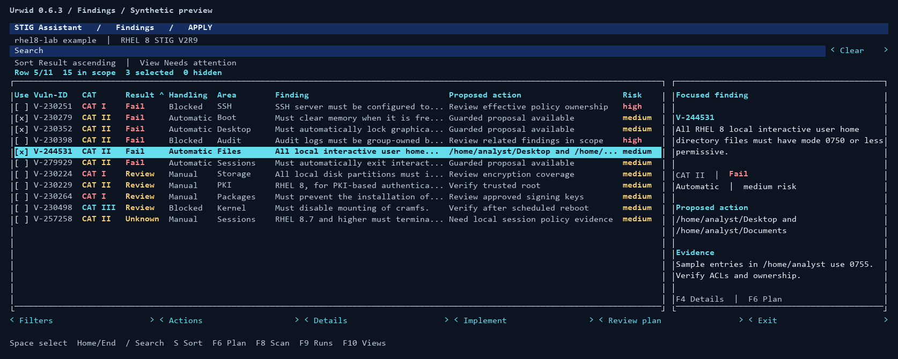
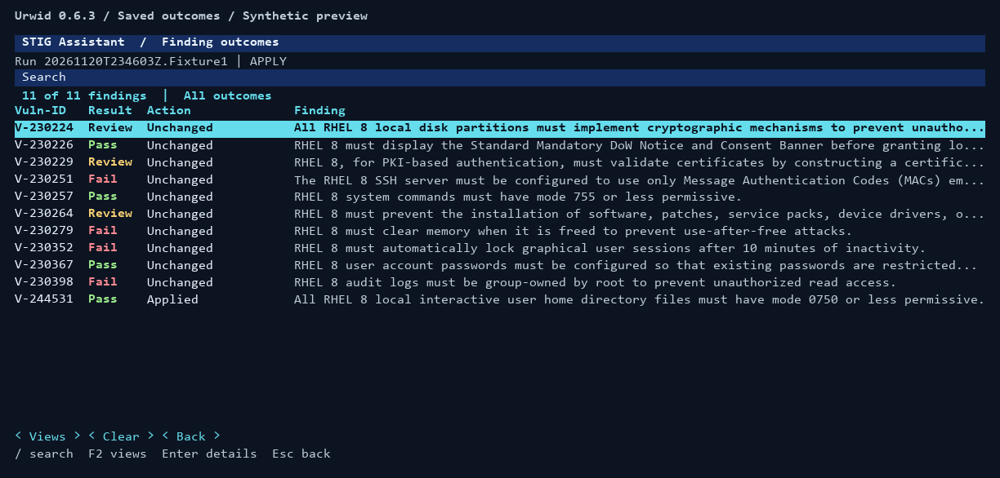

# RHEL 8 STIG Assistant

An independent, attended STIG assessment and remediation tool for RHEL 8.10 x86_64. Use the Urwid terminal interface to select findings, review each change, and recheck the host afterward. The release runs as one Bash script.

**Current development release** `0.6.3-urwid-dev`

**Pinned baseline** DISA RHEL 8 STIG Version 2 Release 9 (Sunset), with 68 registered rules. [DISA STIG announcements](https://www.cyber.mil/stigs/stig-announcements)

Coverage is limited to the registered rules. Some rules provide assessment and administrator guidance, and eligible changes require attended approval. Check your organization's approved baseline before using results as compliance evidence. [Rule coverage](docs/rule-coverage.md)

## Get started

Download `rhel8-stig-urwid.sh` and its `.sha256` file, or build the same files from source. Run the block from the directory containing both files on a disposable RHEL 8.10 guest. [GitHub release](https://github.com/aaronwagner26/rhel8-stig-assistant/releases/tag/v0.6.3-urwid-dev) · [Build instructions](#build-from-source)

```bash
(
  set -e
  sha256sum --check rhel8-stig-urwid.sh.sha256
  chmod 0755 rhel8-stig-urwid.sh
  ./rhel8-stig-urwid.sh --version
  ./rhel8-stig-urwid.sh --ui-check
  ./rhel8-stig-urwid.sh --gui --status
)
```

**Status** assesses settings and saves protected reports. Begin with it to get familiar with the workspace. **Apply** requires an explicit `--apply`, root, an interactive terminal, and attended approval. The 0.6.3 development release was tested offline with signed RHEL runtime packages in a Rocky Linux 8.10 container. Interactive acceptance on a genuine RHEL 8.10 guest is pending. [Validation record](docs/validation.md)

| To do this | Start here |
| --- | --- |
| Preview the catalog | `./rhel8-stig-urwid.sh --list` |
| Read the policy and local handling for a rule | `./rhel8-stig-urwid.sh --explain V-230494` |
| Assess a limited scope from the command line | `./rhel8-stig-urwid.sh --status --only V-230494,V-230498` |
| Preview eligible changes | `./rhel8-stig-urwid.sh --diff --only V-230494,V-230498` |
| Review saved work | Launch `--gui --status` and press `F9` in **Run settings** |

The full-screen UI uses Python 3 and Urwid. For legacy CKL import, install Python 3 with Expat. Full file-content diffs use `diffutils`. `--ui-check` reports what the guest can use, and ordinary CLI modes work without Urwid. See the [operator guide](docs/operator-guide.md) for runtime details, review and approval behavior, and a Status walkthrough.

## Interface

**Findings** shows the selected IDs, active filters, current assessment, and a detail panel. Search by ID or text, use the headers to sort, or paste a batch of IDs and inspect what the selection will include.



**Results** records what passed, what changed, what remains open, and what needs activation or another verification. Open the per-finding evidence, preview a change-ticket handoff, or compare a new read-only recheck with the original report.



The screenshots use synthetic fixture data.

## Build from source

```bash
python3 tools/build.py
bash -n dist/rhel8-stig-urwid.sh
(cd dist && sha256sum --check rhel8-stig-urwid.sh.sha256)
python3 tests/smoke.py
```

The build checks the pinned classic backend digest and embeds the Urwid sources in `dist/rhel8-stig-urwid.sh`. The script contents are reproducible. The run-time prerequisite check is available from the built script. The smoke check uses Bash and the Python standard library. [Optional Urwid fixture tests](tests/urwid/README.md)

| Path | Contents |
| --- | --- |
| `src/classic/` | Pinned assessment, remediation, and recovery engine |
| `src/urwid/` | Terminal views, runtime, and Bash bridge |
| `tools/` | Build and release utilities |
| `tests/` | Regression tests and synthetic fixtures |
| `examples/` | Sample scope and site settings |
| `docs/` | Operator guide, screenshots, and validation notes |
| `dist/` | Locally generated script and checksum |

## Project records

- [Architecture](docs/architecture.md) explains the source layout and how the terminal interface uses the Bash engine.
- [Changelog](CHANGELOG.md) describes the development versions.
- [Validation](docs/validation.md) records evidence for the exact 0.6.3 bytes.
- [Release process](docs/releasing.md) covers changes, versioning, verification, and publication.
- [Contributing](CONTRIBUTING.md) covers source changes and operator feedback.
- [Security](SECURITY.md) explains how to share a concern privately.
- [Third-party notices](THIRD_PARTY_NOTICES.md) identifies the DISA baseline and runtime dependency. A project license has yet to be selected.
